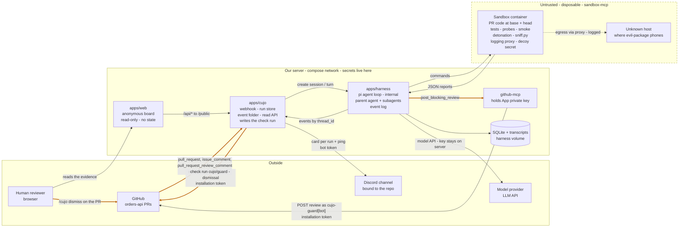

# Architecture

## The idea

A diff shows what changed. It does not show what happens: the test that now
fails, the endpoint that now returns 500, the install-time payload in a new
dependency. Cujo reviews a pull request by running it in a disposable sandbox.
It runs the tests on base and head, probes the changed code, boots the app, and
installs each new dependency under sensors. The review cites what happened.

Running a pull request runs a stranger's code. So it runs where it holds no
credentials and has no path back to the server, and the sandbox is destroyed
after the run.

Not every pull request needs a sandbox (decision 133). The **diff review**
reads the diff and the repository's standards files on the trusted side, with
no sandbox, and posts one advisory review with findings at most `warn`. The
**sandbox review** runs the code. A repository picks with `mode:` in
`.cujo.yml`; a dependency-manifest change or a bot-authored pull request always
gets the sandbox (decision 135).

**Where this is going.** Cujo is becoming a plugin-based review gate
(decision 180): plugins produce evidence, one policy decides, and the verdict
is signed. The design is in [gate/](gate/README.md), five short pages.
Everything below describes what runs today and stays true until a gate pull
request replaces a path, each with its own decision.

## Components

| Piece | Role |
|-------|------|
| **`apps/harness`** | The agent harness on the pi coding agent SDK: sessions, turns, the event log and the sub-agent tool; reached only by `apps/cujo` (decisions 123, 138). |
| **Cujo agent** | The parent reviewer: a model with the rubric, a sandbox, check subagents and a review tool; it merges the reports into findings and posts. |
| **Diff reviewer** | A second rubric, `agent/DIFF.md`, on its own session with `github-mcp` only and a token budget (decisions 132, 133, 137). |
| **Check subagents** | One per check (`tests`, `probes`, `smoke`, `detonation`), each a nested pi session that returns one JSON report (decision 124). |
| **The sandbox** | A disposable container per turn that holds the untrusted pull request code, provisioned by `sandbox-mcp`. |
| **`sandbox/`** | The in-sandbox sensor code, `sniff.py` and `cujo_sniff/`; each report says which sensors were watching (decision 54). |
| **`apps/cujo`** | The harness's only client and the only service GitHub touches: webhook, registry, run store, read API, owner plane, and the `cujo/guard` check run (decisions 57, 138, 151, 153). |
| **`apps/web`** | The UI: the public board, the owner pages and the static manual at `/docs`; it holds no secrets and no state (decisions 98, 175). |
| **Cujo GitHub App** | The bot identity, `cujo-guard[bot]`. |
| **`github-mcp`** | The MCP server that posts the review as the App. |
| **`sandbox-mcp`** | The MCP server that is the sandbox: five tools over a `local` or `daytona` runtime, plus a staging route for private trees (decisions 113, 158, 161, 167). |
| **The egress gateway** | One container per sandbox that routes, resolves and filters its traffic to `allow_hosts`; default deny (decisions 116, 121). |
| **Discord notifier** | Part of `apps/cujo`: one card per run and one ping on a block; it notifies only (decision 23). |
| **`/cujo` command** | Part of `apps/cujo`: a Discord server picks its channel and ping role (Contract 8). |
| **`ocr-sidecar`** | An optional second review by Open Code Review, stored per run and posted nowhere (decision 149). |
| **`mapper`** | An optional service that indexes base and head trees and answers what a diff reaches (decision 172, Contract 12). |
| **Demo repos** | `orders-api`, the app under protection, and `evil-package`, a staged malicious dependency. |

## The trust boundary

Two zones, with a narrow bridge between them.

- **Trusted (the server):** `apps/harness`, the agent and its keys,
  `apps/cujo`, `github-mcp`, `sandbox-mcp`, and every secret.
- **Untrusted and disposable (the sandbox):** the pull request code, its
  dependencies, the subagents' scripts, `sandbox/`, and the logging proxy.

In: the pull request code and public metadata, dependency names, Cujo's own
sensor code and commands, and a public run's own id (decision 36). Out: JSON
reports. No secret ever enters the sandbox. A diff run never opens the bridge.

## System map

`apps/cujo` is the only service GitHub touches. A person reads the board and
lifts a block on the pull request. Thick edges are the block and the unlock.



Every crossing, with what it carries and what protects it:

| From → To | Transport | What crosses | Auth |
|-----------|-----------|--------------|------|
| GitHub → `apps/cujo` | HTTPS webhook on `cujo-ingress` | Pull request events (repo, number, SHAs) and the App's `installation` events for the registry (decision 151) | HMAC signature |
| `apps/cujo` → `apps/harness` | HTTP on the compose network (`packages/harness-contract`) | Sessions, turns with the pull request context, the event stream, and `GET /events` on restart | None; the harness has no public route |
| `apps/harness` → `apps/cujo` | The same stream | Events by `threadId`: `thread.created`, `model.message`, `tool.response`, `thread.done` | Same connection |
| Agent → `sandbox-mcp` → sandbox | MCP, then `docker exec` | Pull request code (a tokenless clone, or staged private trees under a single-use ticket), public metadata, dependency names, Cujo's sensor code and commands, a public run's id, and earlier detonation entries (decisions 36, 145, 158) | Internal; image, runtime and host paths are never tool inputs; no clone credential in the box |
| Sandbox → the harness | `sandbox_exec` stdout | One escaped JSON report per check; a stream over 32 KB comes back as head and tail (decision 142) | None; treated as untrusted data |
| Sandbox → anyone else | — | **Nothing.** The harness serves no download; `sandbox_read_file` is bounded by `max_bytes` (decision 113) | Nothing to close |
| Sandbox → internet | The egress gateway (decision 116) | Only hosts in `allow_hosts`; the in-sandbox proxy still records every attempt in `egress[]` | Default deny outside the box |
| `.cujo.yml` → the gateway | `allow_hosts` on `sandbox_create` | Hostnames only, at most 32, validated and refused, never repaired (decision 116) | `apps/sandbox-mcp/src/allowlist.ts` |
| `apps/cujo` → `mapper` | HTTP on the compose network | Base and head tarballs under a single-use key, then a changed-file list; no token, URL or hostname | Internal; the mapper makes no outbound call |
| `apps/harness` → model provider | HTTPS, Anthropic or OpenAI-compatible (decision 174) | Prompts, reports, tool calls | One key per provider, set on the board and registered by `apps/cujo`; never in the harness environment |
| `apps/harness` → `github-mcp` | MCP | `post_advisory_review` or `post_blocking_review`, one call, not held (decision 138) | Internal |
| `github-mcp` → GitHub | REST | The review as `cujo-guard[bot]`, composed by `@cujo/review-render`, with inline comments for anchored findings (decision 74) | Installation token |
| `apps/cujo` → GitHub | REST | One reaction on the pull request description (Contract 9; decision 38) | Installation token, `pull_requests: write` |
| `apps/cujo` → GitHub | REST | A reply and a reaction, only to a person who addressed Cujo (decision 43) | Installation token, `pull_requests: write` |
| `apps/cujo` → `apps/harness` | HTTP | A second session per pull request for conversation, with no review tool (Contract 10) | Internal |
| Human → `apps/web` | HTTPS on `cujo.spencerjireh.com` | The public board and run pages, redacted by `http/public/serialize.ts`; a signed-in owner also sees `/owner/*` (decisions 57, 153, 159, 175) | None for the board; a session cookie for an owner |
| `apps/cujo` → GitHub | REST | The `cujo/guard` check run, and on `/cujo dismiss` the dismissal of the bot's review (decision 138) | Installation token, `checks: write`, `pull_requests: write` |
| `apps/cujo` → GitHub | REST, then the archive redirect | Base and head tarballs of a private repository (decision 158) | Installation token on the API request only |
| `apps/cujo` → `sandbox-mcp` → sandbox | MCP, then `docker exec` | On a judge run: create, `prepare`, `setup`, the declared `install` and `test` lines, `report`, destroy (decision 161) | Internal; no credential |
| `apps/cujo` → `sandbox-mcp` | `PUT /stage/<ticket>/<tree>` | The two private tarballs, single use, on tmpfs, swept after 30 minutes | Internal; the ticket buys one copy |
| `apps/cujo` → `ocr-sidecar` | HTTP | Repository, number, public clone URL, SHAs, title and body; fire-and-forget (decision 149) | None; the sidecar refuses other clone URLs |
| `ocr-sidecar` → GitHub | Tokenless `git clone` | The fetch only; head must match the named SHA | None; no credential to leak |
| `ocr-sidecar` → model provider | HTTPS | The diff and files `ocr` reads; the repository's `.opencodereview/` is deleted first | `OCR_LLM_TOKEN` |
| `ocr-sidecar` → `apps/cujo` | The same response | `ocr`'s JSON envelope, stored in `run_ocr_reviews`, never public | Same connection |
| `apps/web` → `apps/cujo` | HTTP | `/auth/*` for sign-in and `/owner/*` with the session as a bearer (decision 153) | The session, stored hashed |
| `apps/cujo` → GitHub | HTTPS | The OAuth code exchange, then three reads to decide owner status; the token is not kept | The App's OAuth client secret |
| Discord → `apps/cujo` | HTTPS on `cujo-ingress` | A `/cujo` interaction (Contract 8) | Ed25519 against `DISCORD_PUBLIC_KEY`; invalid is 401 |
| `apps/cujo` → Discord | HTTPS | One card per run, every string escaped and mention-suppressed (Contract 7) | `DISCORD_BOT_TOKEN`, held only by `apps/cujo` |

## The block and the unlock

Nothing is held (decision 138). A `critical` finding posts a REQUEST_CHANGES
review at once, and `apps/cujo` fails the `cujo/guard` check run. Branch
protection holds the merge until a person with write access, who is not the
author and not a bot, comments `/cujo dismiss` on the pull request.

```mermaid
sequenceDiagram
  autonumber
  participant GH as GitHub
  participant C as apps/cujo
  participant TF as apps/harness
  participant Sub as Check subagents
  participant H as Human
  participant M as github-mcp

  GH->>C: pull_request webhook (HMAC)
  C->>GH: check run cujo/guard: in_progress
  C->>TF: POST /sessions, POST /turns (PR context), subscribe
  TF->>Sub: create_sub_agent x tests, probes, smoke, detonation
  Sub-->>TF: JSON report
  Note over TF: a hard rule forces critical
  TF->>M: post_blocking_review(the findings)
  M->>GH: REQUEST_CHANGES review as cujo-guard[bot]
  TF-->>C: turn.done
  C->>C: run status = blocked
  C->>GH: check run cujo/guard: failure
  H->>GH: /cujo dismiss on the pull request
  GH->>C: issue_comment webhook (HMAC)
  C->>GH: who is this person? (write, not the author, not a bot)
  C->>GH: dismiss the bot's review; check run: neutral, "Dismissed by @login"
  C->>C: run status = dismissed, approver = github:login
```

A block is terminal until a dismissal. The dismissal is claimed in the store
before GitHub is written, so two racing comments dismiss once (Contract 1). A
new commit gets its own run, review and check; a block is never carried
forward. With no `critical` finding the agent calls `post_advisory_review`;
with one it calls `post_blocking_review`; never both. A new head pushed during
a run ends that run `superseded`.

## End-to-end flow

1. A pull request opens or updates; the App sends a webhook to `apps/cujo`.
2. `apps/cujo` resolves the mode (Contract 1). A diff run reads the diff and posts one advisory review (Contract 11).
3. On a judge run, `apps/cujo` provisions the sandbox and runs the declared install and tests with no model (decision 161); on a gather run the agent does this.
4. Check subagents run `tests`, `probes`, `smoke` and `detonation` under the sensors and return JSON reports (Contract 2).
5. The parent turns reports into findings; hard rules force `critical` (Contract 3).
6. `github-mcp` posts the review; a block fails `cujo/guard` until `/cujo dismiss` (Contract 4).

## User flows

- **A. Nothing is wrong.** Four checks run, one COMMENT review posts, the reaction ends `clean` (Contract 9).
- **B. The pull request breaks something.** A head-only test failure forces `critical`; the fix commit gets its own run and a passing check.
- **C. "Prove it."** A maintainer asks in a review thread; Cujo answers from a session with no write tool (Contract 10, decision 47).
- **D. The unlock.** Unknown egress during an install blocks the merge; a maintainer with write access comments `/cujo dismiss` (decisions 44, 138).
- **F. Outside contributor.** A fork author reads every finding; Cujo refuses their `/cujo` commands and `@cujo-guard` messages, out loud.

## Deployment topology

One Hetzner server runs every service in one Coolify `docker-compose` project.
The Coolify control plane runs on a separate host that never runs untrusted
code. Configuration is environment variables set in Coolify; `.env.example`
lists every name. Models and providers are set on the board, not in the
environment (decision 174).

| Service | Port | Reached by | Holds |
|---------|------|------------|-------|
| `web` | 3000, published as `cujo.spencerjireh.com` | People | Nothing; proxies `GET /public/*` and the owner routes to `cujo` |
| `cujo` | 8080, published as `cujo-ingress.spencerjireh.com` for `/webhook` and `/discord/interactions` | GitHub, Discord, `web` (as `cujo`) | App key, OAuth client secret, Discord token, model keys, the SQLite run store |
| `harness` | 8790, internal | `cujo` | Model keys in memory, SQLite event log and pi transcripts |
| `github-mcp` | 8081, internal | `harness` | The App private key |
| `sandbox-mcp` | 8082, internal | `harness`, `cujo` | The host Docker socket; builds the sandbox and gateway images at boot and rebuilds one the host pruned (decisions 114, 118, 181) |
| `ocr-sidecar` | 8083, internal, optional | `cujo` | `OCR_LLM_*` only (decision 149) |
| `mapper` | 8084, internal, optional | `cujo` | No secret (decision 172) |

Every service logs JSON to stdout through `@cujo/log`; `CUJO_LOG_LEVEL`
defaults to `info` (decision 37).

Hard rules:

- The host needs Docker 28 or later: the gateway uses `network connect --gw-priority` (decision 121).
- Merging to `main` is the deploy. A variable edited in Coolify applies at the next deploy, so an env-coupled change must be valid before and after the swap (decision 35).
- A compose service that exits at start reads to Coolify as the whole application exiting. A service with missing configuration boots, stays healthy and answers 503.
- A Hetzner firewall accepts ports 80 and 443 only from Cloudflare's ranges; port 22 stays open for the control plane (decision 33).
- A Cloudflare rate-limiting rule bounds the public stream route per address (429); the process caps concurrent streams (503) (decision 34).
